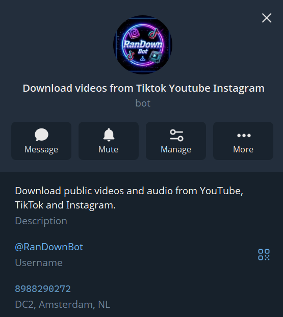
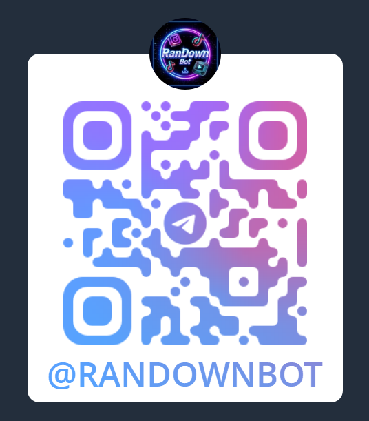
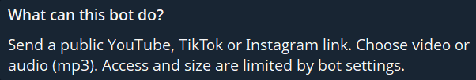

# RanDownBot
Telegram bot: downloads videos and audio from YouTube, TikTok and Instagram

## At the moment, the bot works by invitation, text to the author to get the access!!!

[LINK](https://t.me/RanDownBot)

## Responsible use and legal notice

RanDownBot is an independent personal project. Access is currently
invitation-only. This repository presents the project; it does not publish
the bot's application source code.

Use the bot only for content you own or are authorized to download, and only
where applicable law and the relevant platform terms permit it.

Public availability and personal or non-commercial use do not by themselves
grant permission to download or redistribute content. Access to the bot
does not grant any rights to third-party media.

The bot is not intended to bypass DRM, paywalls, account permissions, or
other access controls. Do not submit credentials, session cookies, private
content, or links you are not authorized to use.

RanDownBot is not affiliated with, endorsed by, or sponsored by YouTube,
TikTok, Instagram, Telegram, or their respective owners.

Availability and platform support are not guaranteed. Access may be limited
or suspended in response to misuse, technical restrictions, or substantiated
rights concerns.

For a specific copyright or other rights concern relating to the project
or bot, please contact the maintainer through the contact method listed on
the GitHub profile. Provide only the information necessary to identify the
concern; do not send passwords, cookies, tokens, or private media.

## Features

- Download YouTube, TikTok, Instagram videos
- Download MP4 or MP3.
- Queue 1 simultaneous download, with progress, cancellation and send as file actions.
- Paste or drag URLs.
- Limits:50 mb max file size, 15 min max duration, 20 requests per day.
- Available 3 languages: Kazakh, English, Russian.
- Without saving any your data, include URLs and texts.\

## Screenshots

These previews are labelled placeholders, not application captures. Replace them with the PNG files in the [screenshot checklist](docs/images/README.md), then update these image links.

| View | Placeholder | Required real file |
| --- | --- | --- |
| Profile Pictuce |  | `images/pfp.png` |
| Telegram Profile |  | `images/profile.png` |
| QR |  | `images/qr.png` |
| About |  | `images/about.png` |
